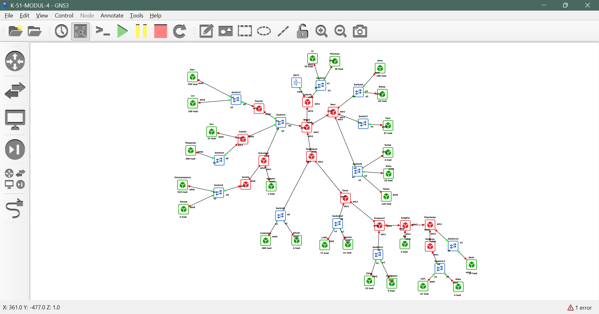
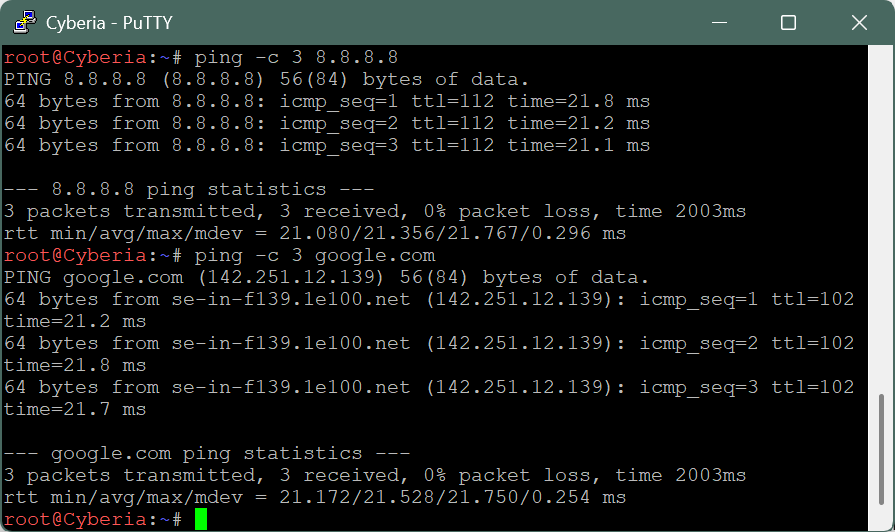
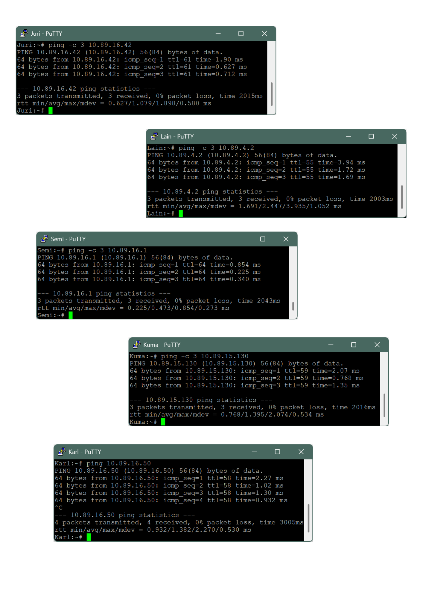

# Laporan Resmi Praktikum Modul 4 — Komunikasi Data & Jaringan Komputer 2026
## Layer:04 — The Wired Expansion (Serial Experiments Lain)

**Kelompok:** [K-XX] — Group [A]

| Nama | NRP | Bagian |
|---|---|---|
| Arrumanta Ekna Luhkinasih | 5027251044 | Perhitungan VLSM & implementasi GNS3 |
| Muhammad Hugo Rayandra | 5027251076 | Perhitungan CIDR & implementasi Cisco Packet Tracer |

---

## Daftar Isi
1. [Deskripsi Soal](#1-deskripsi-soal)
2. [Topologi](#2-topologi)
3. [Perhitungan Kebutuhan IP](#3-perhitungan-kebutuhan-ip)
4. [VLSM (GNS3)](#4-vlsm-gns3)
5. [CIDR (Cisco Packet Tracer)](#5-cidr-cisco-packet-tracer)
6. [Konfigurasi GNS3](#6-konfigurasi-gns3)
7. [Routing](#7-routing)
8. [Pengujian](#8-pengujian)
9. [Kendala](#9-kendala)

---

## 1. Deskripsi Soal
Membangun ulang jaringan The Wired dalam skala besar. Router **Cyberia** menjadi satu-satunya router yang terhubung ke internet melalui NAT (GNS3) / Cloud (CPT). Pembagian IP dan routing harus seefisien mungkin, dan seluruh node harus dapat saling ping.

Ketentuan:
- GNS3 menggunakan **VLSM**, Cisco Packet Tracer menggunakan **CIDR**.
- Prefix IP kelompok: **10.89**
- Jumlah IP tiap subnet = jumlah host + jumlah interface router pada subnet tersebut.
- Image yang digunakan: `ardhptr21/debinet:latest` (router) dan `ardhptr21/alpinet:latest` (client).

## 2. Topologi
### GNS3


### Cisco Packet Tracer


**Komponen GNS3:**
| Komponen | Implementasi |
|---|---|
| NAT1 | Node NAT bawaan GNS3 |
| Router (13) | Docker node `debinet` dengan IP forwarding aktif |
| Switch (13) | Ethernet switch bawaan GNS3 |
| Client (25) | Docker node `alpinet` |

## 3. Perhitungan Kebutuhan IP
Jumlah IP = host + interface router. Network ID dan broadcast tidak dimasukkan ke jumlah IP, tetapi diperhitungkan saat memilih prefix, karena prefix dipilih berdasarkan jumlah IP **usable** (2ⁿ − 2).

| Subnet | Rute | Jumlah IP | Netmask |
|---|---|---|---|
| A1 | Psyche > Switch3 > Karl, Lin | 881 | /22 |
| A2 | Accela > Switch5 > Omnipresence, Denpa | 514 | /22 |
| A3 | Copland > Switch4 > Masayuki | 301 | /23 |
| A4 | Tachibana > Switch9 > Collective, Ghost | 267 | /23 |
| A5 | Navi > Switch6 > Alice, Reika | 254 | /24 |
| A6 | Navi > Switch8 > Yasuo, Miho, Kuma | 143 | /24 |
| A7 | Cyberia > Switch1 > JJ, MyuMyu | 126 | /25 |
| A8 | Deus > Switch10 > Lilith, Specter | 99 | /25 |
| A9 | Shibuya > Switch13 > Lain, Mika | 62 | /26 |
| A10 | Navi > Switch7 > Taro | 58 | /26 |
| A11 | Protocol7 > Switch11 > Chisa, Hodgeson | 33 | /26 |
| A12 | Copland > Juri | 32 | /26 |
| A13 | Phantoma > Switch12 > Semi | 15 | /27 |
| A14 | Wired > Switch2 > Psyche, Copland, Schumann | 4 | /29 |
| A15 | Schumann > Akashic | 4 | /29 |
| A16 | Knights > Eiri | 3 | /29 |
| A17 | Cyberia > Wired | 2 | /30 |
| A18 | Wired > Navi | 2 | /30 |
| A19 | Wired > Tachibana | 2 | /30 |
| A20 | Schumann > Accela | 2 | /30 |
| A21 | Tachibana > Deus | 2 | /30 |
| A22 | Deus > Protocol7 | 2 | /30 |
| A23 | Protocol7 > Knights | 2 | /30 |
| A24 | Knights > Phantoma | 2 | /30 |
| A25 | Phantoma > Shibuya | 2 | /30 |
| **Total** | | **2814** | **/19** |

Contoh perhitungan:
- **A2:** 510 + 3 + 1 = 514. /23 hanya punya 510 IP usable, sehingga harus naik ke **/22** (1022 usable).
- **A14:** tidak ada host, tetapi ada 4 interface router, sehingga butuh 4 IP. /30 hanya punya 2 IP usable, sehingga harus naik ke **/29** (6 usable).

Total ukuran blok yang terpakai adalah 4316 alamat. /20 (4096) tidak cukup, sehingga blok induknya **10.89.0.0/19**.

## 4. VLSM (GNS3)
Langkah:
1. Hitung kebutuhan IP tiap subnet.
2. Tentukan prefix terkecil yang jumlah IP usable-nya mencukupi.
3. Urutkan subnet dari kebutuhan terbesar ke terkecil.
4. Alokasikan berurutan mulai dari 10.89.0.0. Setiap subnet dimulai tepat setelah broadcast subnet sebelumnya.

### Pohon VLSM


### Pembagian IP
| Subnet | Network ID | Netmask | Broadcast | Range IP |
|---|---|---|---|---|
| A1 | 10.89.0.0 | 255.255.252.0 | 10.89.3.255 | 10.89.0.1 – 10.89.3.254 |
| A2 | 10.89.4.0 | 255.255.252.0 | 10.89.7.255 | 10.89.4.1 – 10.89.7.254 |
| A3 | 10.89.8.0 | 255.255.254.0 | 10.89.9.255 | 10.89.8.1 – 10.89.9.254 |
| A4 | 10.89.10.0 | 255.255.254.0 | 10.89.11.255 | 10.89.10.1 – 10.89.11.254 |
| A5 | 10.89.12.0 | 255.255.255.0 | 10.89.12.255 | 10.89.12.1 – 10.89.12.254 |
| A6 | 10.89.13.0 | 255.255.255.0 | 10.89.13.255 | 10.89.13.1 – 10.89.13.254 |
| A7 | 10.89.14.0 | 255.255.255.128 | 10.89.14.127 | 10.89.14.1 – 10.89.14.126 |
| A8 | 10.89.14.128 | 255.255.255.128 | 10.89.14.255 | 10.89.14.129 – 10.89.14.254 |
| A9 | 10.89.15.0 | 255.255.255.192 | 10.89.15.63 | 10.89.15.1 – 10.89.15.62 |
| A10 | 10.89.15.64 | 255.255.255.192 | 10.89.15.127 | 10.89.15.65 – 10.89.15.126 |
| A11 | 10.89.15.128 | 255.255.255.192 | 10.89.15.191 | 10.89.15.129 – 10.89.15.190 |
| A12 | 10.89.15.192 | 255.255.255.192 | 10.89.15.255 | 10.89.15.193 – 10.89.15.254 |
| A13 | 10.89.16.0 | 255.255.255.224 | 10.89.16.31 | 10.89.16.1 – 10.89.16.30 |
| A14 | 10.89.16.32 | 255.255.255.248 | 10.89.16.39 | 10.89.16.33 – 10.89.16.38 |
| A15 | 10.89.16.40 | 255.255.255.248 | 10.89.16.47 | 10.89.16.41 – 10.89.16.46 |
| A16 | 10.89.16.48 | 255.255.255.248 | 10.89.16.55 | 10.89.16.49 – 10.89.16.54 |
| A17 | 10.89.16.56 | 255.255.255.252 | 10.89.16.59 | 10.89.16.57 – 10.89.16.58 |
| A18 | 10.89.16.60 | 255.255.255.252 | 10.89.16.63 | 10.89.16.61 – 10.89.16.62 |
| A19 | 10.89.16.64 | 255.255.255.252 | 10.89.16.67 | 10.89.16.65 – 10.89.16.66 |
| A20 | 10.89.16.68 | 255.255.255.252 | 10.89.16.71 | 10.89.16.69 – 10.89.16.70 |
| A21 | 10.89.16.72 | 255.255.255.252 | 10.89.16.75 | 10.89.16.73 – 10.89.16.74 |
| A22 | 10.89.16.76 | 255.255.255.252 | 10.89.16.79 | 10.89.16.77 – 10.89.16.78 |
| A23 | 10.89.16.80 | 255.255.255.252 | 10.89.16.83 | 10.89.16.81 – 10.89.16.82 |
| A24 | 10.89.16.84 | 255.255.255.252 | 10.89.16.87 | 10.89.16.85 – 10.89.16.86 |
| A25 | 10.89.16.88 | 255.255.255.252 | 10.89.16.91 | 10.89.16.89 – 10.89.16.90 |

## 5. CIDR (Cisco Packet Tracer)
> Diisi oleh Muhammad Hugo Rayandra.

### Tahap Penggabungan
[Tabel penggabungan tahap I sampai akhir]

### Pohon CIDR


### Pembagian IP CIDR
[Tabel pembagian IP CIDR]

### Konfigurasi CPT
[Konfigurasi interface, static route, dan Cloud]

## 6. Konfigurasi GNS3
Semua script disimpan di `/root` pada masing-masing node. Script dijalankan otomatis saat node start melalui **Edit network configuration**:

```
auto eth0
iface eth0 inet manual
    up sh /root/<nama-node>.sh
```

Khusus Cyberia, eth0 menggunakan DHCP dari NAT1:
```
auto eth0
iface eth0 inet dhcp

auto eth1
iface eth1 inet manual
    up sh /root/cyberia.sh
```

### Mapping Interface Router
| Router | eth0 | eth1 | eth2 | eth3 |
|---|---|---|---|---|
| Cyberia | NAT1 (DHCP) | Switch1 — 10.89.14.1/25 | Wired — 10.89.16.57/30 | – |
| Wired | Cyberia — 10.89.16.58/30 | Switch2 — 10.89.16.33/29 | Navi — 10.89.16.61/30 | Tachibana — 10.89.16.65/30 |
| Psyche | Switch2 — 10.89.16.34/29 | Switch3 — 10.89.0.1/22 | – | – |
| Copland | Switch2 — 10.89.16.35/29 | Juri — 10.89.15.193/26 | Switch4 — 10.89.8.1/23 | – |
| Schumann | Switch2 — 10.89.16.36/29 | Akashic — 10.89.16.41/29 | Accela — 10.89.16.69/30 | – |
| Accela | Schumann — 10.89.16.70/30 | Switch5 — 10.89.4.1/22 | – | – |
| Navi | Wired — 10.89.16.62/30 | Switch6 — 10.89.12.1/24 | Switch7 — 10.89.15.65/26 | Switch8 — 10.89.13.1/24 |
| Tachibana | Wired — 10.89.16.66/30 | Switch9 — 10.89.10.1/23 | Deus — 10.89.16.73/30 | – |
| Deus | Tachibana — 10.89.16.74/30 | Switch10 — 10.89.14.129/25 | Protocol7 — 10.89.16.77/30 | – |
| Protocol7 | Deus — 10.89.16.78/30 | Switch11 — 10.89.15.129/26 | Knights — 10.89.16.81/30 | – |
| Knights | Protocol7 — 10.89.16.82/30 | Eiri — 10.89.16.49/29 | Phantoma — 10.89.16.85/30 | – |
| Phantoma | Knights — 10.89.16.86/30 | Switch12 — 10.89.16.1/27 | Shibuya — 10.89.16.89/30 | – |
| Shibuya | Phantoma — 10.89.16.90/30 | Switch13 — 10.89.15.1/26 | – | – |

### Script Router

<details>
<summary><b>Cyberia</b></summary>

```sh
#!/bin/sh
echo 1 > /proc/sys/net/ipv4/ip_forward

# eth0 ke NAT1
ip link set eth0 up
LEASE=""
if command -v dhclient >/dev/null 2>&1; then
  dhclient eth0
elif [ -x /gns3/bin/busybox ]; then
  LEASE=$(/gns3/bin/busybox udhcpc -i eth0 -q -n 2>&1 | grep -o 'lease of [0-9.]*' | awk '{print $3}')
fi
if ! ip -4 addr show eth0 | grep -q inet; then
  ip addr add ${LEASE:-192.168.122.250}/24 dev eth0
fi
ip route show default | grep -q default || ip route add default via 192.168.122.1

ip addr flush dev eth1; ip addr add 10.89.14.1/25 dev eth1; ip link set eth1 up
ip addr flush dev eth2; ip addr add 10.89.16.57/30 dev eth2; ip link set eth2 up
ip route add 10.89.0.0/19 via 10.89.16.58 2>/dev/null

iptables -t nat -C POSTROUTING -o eth0 -s 10.89.0.0/19 -j MASQUERADE 2>/dev/null || \
iptables -t nat -A POSTROUTING -o eth0 -s 10.89.0.0/19 -j MASQUERADE

echo "nameserver 192.168.122.1" > /etc/resolv.conf
```
</details>

<details>
<summary><b>Wired</b></summary>

```sh
#!/bin/sh
echo 1 > /proc/sys/net/ipv4/ip_forward
ip addr flush dev eth0; ip addr add 10.89.16.58/30 dev eth0; ip link set eth0 up
ip addr flush dev eth1; ip addr add 10.89.16.33/29 dev eth1; ip link set eth1 up
ip addr flush dev eth2; ip addr add 10.89.16.61/30 dev eth2; ip link set eth2 up
ip addr flush dev eth3; ip addr add 10.89.16.65/30 dev eth3; ip link set eth3 up
ip route add default via 10.89.16.57
# cabang Psyche
ip route add 10.89.0.0/22 via 10.89.16.34
# cabang Copland
ip route add 10.89.8.0/23 via 10.89.16.35
ip route add 10.89.15.192/26 via 10.89.16.35
# cabang Schumann
ip route add 10.89.16.40/29 via 10.89.16.36
ip route add 10.89.16.68/30 via 10.89.16.36
ip route add 10.89.4.0/22 via 10.89.16.36
# cabang Navi
ip route add 10.89.12.0/24 via 10.89.16.62
ip route add 10.89.13.0/24 via 10.89.16.62
ip route add 10.89.15.64/26 via 10.89.16.62
# cabang Tachibana
ip route add 10.89.10.0/23 via 10.89.16.66
ip route add 10.89.16.72/30 via 10.89.16.66
ip route add 10.89.14.128/25 via 10.89.16.66
ip route add 10.89.16.76/30 via 10.89.16.66
ip route add 10.89.15.128/26 via 10.89.16.66
ip route add 10.89.16.80/30 via 10.89.16.66
ip route add 10.89.16.48/29 via 10.89.16.66
ip route add 10.89.16.84/30 via 10.89.16.66
ip route add 10.89.16.0/27 via 10.89.16.66
ip route add 10.89.16.88/30 via 10.89.16.66
ip route add 10.89.15.0/26 via 10.89.16.66
```
</details>

<details>
<summary><b>Psyche</b></summary>

```sh
#!/bin/sh
echo 1 > /proc/sys/net/ipv4/ip_forward
ip addr flush dev eth0; ip addr add 10.89.16.34/29 dev eth0; ip link set eth0 up
ip addr flush dev eth1; ip addr add 10.89.0.1/22 dev eth1; ip link set eth1 up
ip route add default via 10.89.16.33
```
</details>

<details>
<summary><b>Copland</b></summary>

```sh
#!/bin/sh
echo 1 > /proc/sys/net/ipv4/ip_forward
ip addr flush dev eth0; ip addr add 10.89.16.35/29 dev eth0; ip link set eth0 up
ip addr flush dev eth1; ip addr add 10.89.15.193/26 dev eth1; ip link set eth1 up
ip addr flush dev eth2; ip addr add 10.89.8.1/23 dev eth2; ip link set eth2 up
ip route add default via 10.89.16.33
```
</details>

<details>
<summary><b>Schumann</b></summary>

```sh
#!/bin/sh
echo 1 > /proc/sys/net/ipv4/ip_forward
ip addr flush dev eth0; ip addr add 10.89.16.36/29 dev eth0; ip link set eth0 up
ip addr flush dev eth1; ip addr add 10.89.16.41/29 dev eth1; ip link set eth1 up
ip addr flush dev eth2; ip addr add 10.89.16.69/30 dev eth2; ip link set eth2 up
ip route add default via 10.89.16.33
ip route add 10.89.4.0/22 via 10.89.16.70
```
</details>

<details>
<summary><b>Accela</b></summary>

```sh
#!/bin/sh
echo 1 > /proc/sys/net/ipv4/ip_forward
ip addr flush dev eth0; ip addr add 10.89.16.70/30 dev eth0; ip link set eth0 up
ip addr flush dev eth1; ip addr add 10.89.4.1/22 dev eth1; ip link set eth1 up
ip route add default via 10.89.16.69
```
</details>

<details>
<summary><b>Navi</b></summary>

```sh
#!/bin/sh
echo 1 > /proc/sys/net/ipv4/ip_forward
ip addr flush dev eth0; ip addr add 10.89.16.62/30 dev eth0; ip link set eth0 up
ip addr flush dev eth1; ip addr add 10.89.12.1/24 dev eth1; ip link set eth1 up
ip addr flush dev eth2; ip addr add 10.89.15.65/26 dev eth2; ip link set eth2 up
ip addr flush dev eth3; ip addr add 10.89.13.1/24 dev eth3; ip link set eth3 up
ip route add default via 10.89.16.61
```
</details>

<details>
<summary><b>Tachibana</b></summary>

```sh
#!/bin/sh
echo 1 > /proc/sys/net/ipv4/ip_forward
ip addr flush dev eth0; ip addr add 10.89.16.66/30 dev eth0; ip link set eth0 up
ip addr flush dev eth1; ip addr add 10.89.10.1/23 dev eth1; ip link set eth1 up
ip addr flush dev eth2; ip addr add 10.89.16.73/30 dev eth2; ip link set eth2 up
ip route add default via 10.89.16.65
ip route add 10.89.14.128/25 via 10.89.16.74
ip route add 10.89.16.76/30 via 10.89.16.74
ip route add 10.89.15.128/26 via 10.89.16.74
ip route add 10.89.16.80/30 via 10.89.16.74
ip route add 10.89.16.48/29 via 10.89.16.74
ip route add 10.89.16.84/30 via 10.89.16.74
ip route add 10.89.16.0/27 via 10.89.16.74
ip route add 10.89.16.88/30 via 10.89.16.74
ip route add 10.89.15.0/26 via 10.89.16.74
```
</details>

<details>
<summary><b>Deus</b></summary>

```sh
#!/bin/sh
echo 1 > /proc/sys/net/ipv4/ip_forward
ip addr flush dev eth0; ip addr add 10.89.16.74/30 dev eth0; ip link set eth0 up
ip addr flush dev eth1; ip addr add 10.89.14.129/25 dev eth1; ip link set eth1 up
ip addr flush dev eth2; ip addr add 10.89.16.77/30 dev eth2; ip link set eth2 up
ip route add default via 10.89.16.73
ip route add 10.89.15.128/26 via 10.89.16.78
ip route add 10.89.16.80/30 via 10.89.16.78
ip route add 10.89.16.48/29 via 10.89.16.78
ip route add 10.89.16.84/30 via 10.89.16.78
ip route add 10.89.16.0/27 via 10.89.16.78
ip route add 10.89.16.88/30 via 10.89.16.78
ip route add 10.89.15.0/26 via 10.89.16.78
```
</details>

<details>
<summary><b>Protocol7</b></summary>

```sh
#!/bin/sh
echo 1 > /proc/sys/net/ipv4/ip_forward
ip addr flush dev eth0; ip addr add 10.89.16.78/30 dev eth0; ip link set eth0 up
ip addr flush dev eth1; ip addr add 10.89.15.129/26 dev eth1; ip link set eth1 up
ip addr flush dev eth2; ip addr add 10.89.16.81/30 dev eth2; ip link set eth2 up
ip route add default via 10.89.16.77
ip route add 10.89.16.48/29 via 10.89.16.82
ip route add 10.89.16.84/30 via 10.89.16.82
ip route add 10.89.16.0/27 via 10.89.16.82
ip route add 10.89.16.88/30 via 10.89.16.82
ip route add 10.89.15.0/26 via 10.89.16.82
```
</details>

<details>
<summary><b>Knights</b></summary>

```sh
#!/bin/sh
echo 1 > /proc/sys/net/ipv4/ip_forward
ip addr flush dev eth0; ip addr add 10.89.16.82/30 dev eth0; ip link set eth0 up
ip addr flush dev eth1; ip addr add 10.89.16.49/29 dev eth1; ip link set eth1 up
ip addr flush dev eth2; ip addr add 10.89.16.85/30 dev eth2; ip link set eth2 up
ip route add default via 10.89.16.81
ip route add 10.89.16.0/27 via 10.89.16.86
ip route add 10.89.16.88/30 via 10.89.16.86
ip route add 10.89.15.0/26 via 10.89.16.86
```
</details>

<details>
<summary><b>Phantoma</b></summary>

```sh
#!/bin/sh
echo 1 > /proc/sys/net/ipv4/ip_forward
ip addr flush dev eth0; ip addr add 10.89.16.86/30 dev eth0; ip link set eth0 up
ip addr flush dev eth1; ip addr add 10.89.16.1/27 dev eth1; ip link set eth1 up
ip addr flush dev eth2; ip addr add 10.89.16.89/30 dev eth2; ip link set eth2 up
ip route add default via 10.89.16.85
ip route add 10.89.15.0/26 via 10.89.16.90
```
</details>

<details>
<summary><b>Shibuya</b></summary>

```sh
#!/bin/sh
echo 1 > /proc/sys/net/ipv4/ip_forward
ip addr flush dev eth0; ip addr add 10.89.16.90/30 dev eth0; ip link set eth0 up
ip addr flush dev eth1; ip addr add 10.89.15.1/26 dev eth1; ip link set eth1 up
ip route add default via 10.89.16.89
```
</details>

### Script Client
Semua client menggunakan template berikut. Nilai IP dan gateway disesuaikan dengan tabel di bawahnya.

```sh
#!/bin/sh
ip addr flush dev eth0
ip addr add <IP>/<PREFIX> dev eth0
ip link set eth0 up
ip route add default via <GATEWAY>
echo "nameserver 192.168.122.1" > /etc/resolv.conf
```

| Client | Subnet | IP | Gateway |
|---|---|---|---|
| JJ | A7 | 10.89.14.2/25 | 10.89.14.1 |
| MyuMyu | A7 | 10.89.14.3/25 | 10.89.14.1 |
| Karl | A1 | 10.89.0.2/22 | 10.89.0.1 |
| Lin | A1 | 10.89.0.3/22 | 10.89.0.1 |
| Juri | A12 | 10.89.15.194/26 | 10.89.15.193 |
| Masayuki | A3 | 10.89.8.2/23 | 10.89.8.1 |
| Akashic | A15 | 10.89.16.42/29 | 10.89.16.41 |
| Omnipresence | A2 | 10.89.4.2/22 | 10.89.4.1 |
| Denpa | A2 | 10.89.4.3/22 | 10.89.4.1 |
| Alice | A5 | 10.89.12.2/24 | 10.89.12.1 |
| Reika | A5 | 10.89.12.3/24 | 10.89.12.1 |
| Taro | A10 | 10.89.15.66/26 | 10.89.15.65 |
| Yasuo | A6 | 10.89.13.2/24 | 10.89.13.1 |
| Miho | A6 | 10.89.13.3/24 | 10.89.13.1 |
| Kuma | A6 | 10.89.13.4/24 | 10.89.13.1 |
| Collective | A4 | 10.89.10.2/23 | 10.89.10.1 |
| Ghost | A4 | 10.89.10.3/23 | 10.89.10.1 |
| Lilith | A8 | 10.89.14.130/25 | 10.89.14.129 |
| Specter | A8 | 10.89.14.131/25 | 10.89.14.129 |
| Chisa | A11 | 10.89.15.130/26 | 10.89.15.129 |
| Hodgeson | A11 | 10.89.15.131/26 | 10.89.15.129 |
| Eiri | A16 | 10.89.16.50/29 | 10.89.16.49 |
| Semi | A13 | 10.89.16.2/27 | 10.89.16.1 |
| Lain | A9 | 10.89.15.2/26 | 10.89.15.1 |
| Mika | A9 | 10.89.15.3/26 | 10.89.15.1 |

## 7. Routing
Routing menggunakan **static route** dengan prinsip efisiensi berikut:

1. **Router ujung** (Psyche, Copland, Accela, Navi, Shibuya) hanya menggunakan **default route** ke router di atasnya, karena semua subnet di bawahnya sudah *directly connected*.
2. **Router tengah** (Schumann, Tachibana, Deus, Protocol7, Knights, Phantoma) menggunakan default route ke atas dan static route **hanya untuk subnet di bawahnya**.
3. **Wired** sebagai hub mengetahui seluruh subnet di setiap cabang, dengan default route ke Cyberia.
4. **Cyberia** cukup menggunakan **satu route ringkas** `10.89.0.0/19 via Wired`, karena seluruh jaringan internal berada di belakang Wired. Subnet milik Cyberia sendiri (A7, A17) tetap diprioritaskan karena lebih spesifik (*longest prefix match*).
5. Cyberia melakukan **NAT (MASQUERADE)** agar seluruh jaringan internal dapat mengakses internet.

## 8. Pengujian
### Koneksi ke internet dari Cyberia


### Koneksi antar cabang
| Asal | Tujuan | Hasil |
|---|---|---|
| Lain | Karl | ✅ |
| Lain | Omnipresence | ✅ |
| Lain | Kuma | ✅ |
| Karl | Eiri | ✅ |
| [...] | [...] | ✅ |



### Traceroute


### Koneksi internet dari client


## 9. Kendala
1. **DHCP client tidak tersedia di image.** `udhcpc` tidak ditemukan dan `dhclient` tidak tersedia, sehingga eth0 Cyberia tidak mendapat IP dari NAT1. Solusi: menggunakan `udhcpc` bawaan GNS3 (`/gns3/bin/busybox`) dengan fallback IP static, ditambah konfigurasi DHCP lewat *Edit network configuration*.
2. **Interface tertukar.** Kabel Schumann (eth1/eth2) dan Eiri (tersambung ke eth1, bukan eth0) tidak sesuai dengan script, sehingga muncul `Destination Host Unreachable`. Solusi: mengecek label interface di GNS3, memasang ulang kabel sesuai mapping, lalu melacak dengan `traceroute` hop demi hop.
3. **Konfigurasi hilang setelah restart node.** IP yang dipasang dengan `ip addr add` tidak persisten. Solusi: script dipanggil otomatis lewat *Edit network configuration* sehingga berjalan setiap node start.